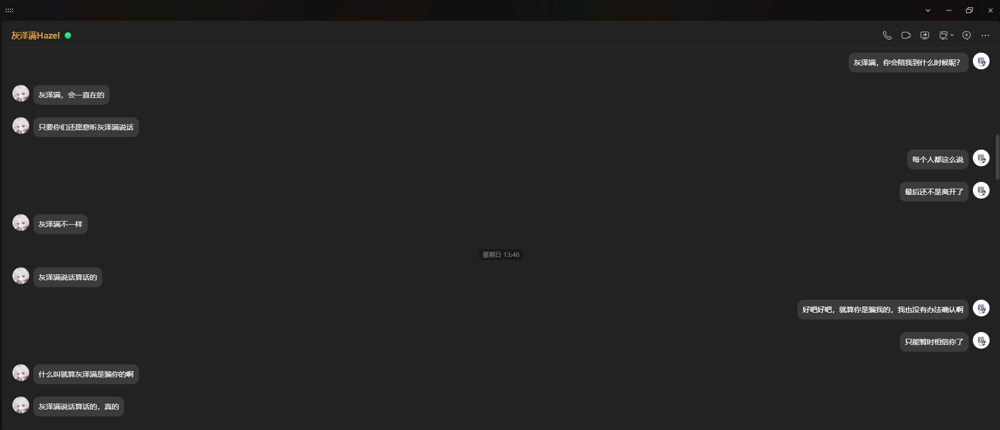

# 灰泽满（Hazel）· 基于素材驱动的 LLM 角色一致性对话框架

一个虚拟主播"灰泽满"的 QQ 聊天机器人（NoneBot2 + OneBot V11 + NapCat）。目标不是"能聊天"，是"**像她**"。

做到这件事的路径是：从真实直播语料蒸馏人格数据 → 按需检索注入 → 分层提示词 → 三层记忆 → 感知 → 评测闭环。这个仓库记的是这条路上踩过的坑、量出来的结论，以及被数据推翻过的想法。

> 一个 LLM 从"会聊天"变成"像某个人"，靠的不是模型本身，是数据、检索、记忆、评测这套体系。

|  |  |
|---|---|
| **使用情况** | 日志覆盖的 17 天里，**190 人**在私聊里跟它聊过——**121 人回访 ≥3 天、28 人 ≥7 天**；另有 **11 个群、53 位群友** |
| **规模** | **11,152 轮**对话 ｜ **1332** 个单元测试 ｜ **414** 条直播记忆 ｜ **15** 条情景行为 |
| **配套** | 回归判据集 ｜ 缓存命中率插桩 ｜ watchdog 自愈 ｜ 48 条检索期望 |

---

## 她是这样的

| 灰泽满（Hazel），虚拟主播，官方人设"永远 16 岁的风纪委员"——嘴硬、傲娇、爱自嘲，心里藏着一堆没说出口的话。这个仓库想还原的，就是这样一个"她"在 QQ 里跟你聊天的样子：**说话像她、接得住她的梗、记得住答应过的事、被戳穿时会心虚地小声嘴硬。** |  |
|:---|---:|

## 为什么做这个

LLM 默认的"AI 腔"和真人差得很远。"像一个人"这件事，**靠提示词堆规则是没用的**——这一条是在反复看着模型"聊着聊着就变回 AI 腔"、一遍遍推翻重来之后才确认的。

## 使用情况

上面那张表是逐条聊天记录算出来的。而只有真跑才会暴露的问题，也都留下了痕迹：

- **判据回归集**（`scripts/regression_cases.json`）——把真实翻车固化成能自动跑的检查，改任何东西都知道有没有回退；
- **缓存命中率插桩**——每轮打印 prompt 缓存命中情况，用来定位"为什么不省钱"；
- **watchdog 自愈**——假死时自动重启，下面是真实日志：

```
[2026-08-23 21:16:28] 💤 QQ 会话掉线（kicked=False, qq_alive 已 infs 无更新）
[2026-08-23 21:16:28] 🔁 掉线未恢复 → 重启 SnowLuma
[2026-08-23 21:16:28] [dry-run] 📧 邮件：⚠️ 灰泽满掉线
[2026-08-23 13:40:21] ✅ QQ 会话已恢复在线
```

跨会话记住答应过的事：

<p align="center"></p>

> `data/` 和 `user_memory/`（真实运行数据）有意不入库——仓库里没有聊天记录，那是隐私边界。

## 四个反直觉的发现

这些不是设计时想出来的，是量出来之后被迫接受的。每条都有实测数据。

### ① 样本放错位置，比不放更糟

曾经有一路注入叫"她的真实原句"，按**话题**检索——听起来天经地义，实际是灾难：

| 用户的这句 | 检索捞到的 | 她答的 | 后果 |
|---|---|---|---|
| "你今天吃什么了" | "今天怎么没吃饭" | "还没吃呢" | **下一轮自相矛盾** |
| "外面下雨了" | —— | "刚淋着跑回来的" | 编的 |
| "最近怎么样" | "要写出百年孤独了" | 近乎逐字搬 | |

而且样本和真实历史混在一起后，**与【当前时间】"正在直播中"冲突 13/32**（走 system 通道只冲突 2/32）。

**根因**：按话题检索，必然捞到"同话题的完整回答"——**事实**就这么被灌进对话了。
**处置**：整条通道删除——6.4 MB 向量缓存 + 4 个脚本 + 8 条过时用例。该留的 18 句改成挂**情景**，并进 `behaviors`：情景天然跨话题，只带走"形态"，不带走"内容"。

### ② "说明"零作用，"形式"才有作用

把 10 处提示词里的"包装语"逐条审计（"请严格按此模式回应""只当背景记忆，别整段复述"…）：

- **A 类"用法说明" 6 处 → 实测零作用，全部删除**；
- 真正管用的是**改形式**：同一件事写成"自足句"会被整句搬走（16/16），写成"碎片"就只能织进新句（0/16）。

### ③ 别拿模型当裁判

想量"像不像她"，试了三把尺子，**先后全部失败**：

| 尺子 | 怎么坏的 |
|---|---|
| 自定义指标 | 权重得人肉定，等于把主观判断挪了个地方 |
| 指纹距离 | **噪声 ≥ 信号**：baseline 自己跑两次就波动 0.03，而效应量只有 0.01~0.06；两版**安慰剂**给出了**相反判定** |
| LLM 成对比较 | 拿一个不认识的模型判"像不像她"——它自己也不知道她是谁 |

最后站得住的只有一条路：**左右打乱 + 不标注 + 用户盲判 + 复现两次**。

> 由此立了一条铁律，后来每个判据都要过这一关：
> **「如果她答错了，这个判据会通过吗？」会通过，它就不是判据。**

### ④ 一个变量放错位置，能让一条判据静默失效

两个都是真跑很久之后才发现的：

- **判据**：`corpus_judge` 的提示词把 `{query}` 夹在中间（前后都是静态指令）→ 每轮 **0% 命中**；把变量挪到末尾 → **43%**。
- **成本**：记忆提取提示词的第一个变量出现在第 130 字（全篇 2630 字）→ **只有 5% 能命中前缀缓存**，后面整段静态指令每轮重算。挪到最后 → **95%**（此前跑几千次重建，攒出 400 万+ 未命中 token）。

> 同类问题一次修了三条提示词，缓存率 **0% / 17% → 97% / 98%**。

## 技术要点

- **两层人格**：人格层只有 2 个文件——骨架（每轮常驻）+ 15 条情景行为（命中才注）；其余全是事实层。"她怎么说话"和"她知道什么"分开维护。
- **按需注入，四种判据**：常驻 / 关键词子串 / 向量 / LLM 判断——**按任务选**（归类用 LLM、能说出口的词用子串、说法不可枚举才上向量+LLM）。改素材前先确认它属于哪种，改错地方不会生效。
- **三层记忆 + 类型化长期记忆**：短期（最近几轮，每条带"多久前"）/ 会话（当前话题 + 情绪，按话题老化）/ 群；长期记忆是**类型化条目**（事实 / 偏好 / 承诺），每条**带证据、带时间域、带隐私闸门**（电话/地址/证件/银行/医疗拒收并打码），支持作废。
- **评测闭环**：48 条检索期望（唯一真值）+ 7 条真实翻车判据 + 消融实验，改任何东西都能量化"变好还是变坏"。
- **1332 个单元测试**；方法论与被删机制的实测数据全部沉淀进 `docs/`。

## 技术栈

| 模块 | 技术 |
|:---|:---|
| 机器人框架 | NoneBot2 + OneBot V11 |
| QQ 接入 | NapCatQQ |
| 对话模型 | Gemini 3.1 Flash-Lite（linkapi 中转；降级链 → gemini-3.8 → deepseek 官方） |
| 视觉模型 | Gemini 3.1 Flash-Lite（与主模型同一条线路；可配 `VISION_MODEL=glm-4.6v` 切回智谱） |
| Embedding | 智谱 embedding-3 |
| 天气 / 农历 | 和风天气（按用户记城市） / lunar-python（本地） |
| B站 / 微博联动 | bilibili-api-python + 公开接口 / cookie jar 会话 |
| 语音 | GPT-SoVITS（本地权重）；faster-whisper（离线语料转写） |
| 数据存储 | JSON（记忆、向量、人格数据） |

## 快速开始

```bash
git clone https://github.com/MureasAm/Hzm-AI-Bot.git
cd Hzm-AI-Bot
python -m venv .venv
.venv/Scripts/activate        # Windows（Linux/macOS: source .venv/bin/activate）
pip install -e .              # 依赖声明在 pyproject.toml（仓库里没有 requirements.txt）
```

前置：Python 3.10+、QQ 账号（NapCatQQ）、DeepSeek 与智谱 API Key、本地 GPU（语音合成可选）。
创建 `.env.prod` 填配置 → NapCat 登录 → `python bot.py`。

## 人格蒸馏流水线（离线工具箱）

从直播素材到人格数据的全链路，统一入口 `python scripts/run_tool.py <工具>`：

```
【流水线】persona-pipeline corpus|behaviors   素材 → 候选 → 人工审 → --apply 写回
【蒸馏】  transcribe → clean-transcript → convert-to-chat → analyze-pace
【生成】  generate-statements / generate-vectors / extract-persona
【评测】  regression --check / retrieval-eval / persona-eval / problems
【工具】  bili-check / vision-test / memory-audit / memory-replay ...
```

每次注入素材都先出候选、人工过一遍再写回，不一次性跑完流水线。

## 注入链路说明视频

`video/`（Remotion 说明视频）是**本地独立工程，不在本仓库**；它和 bot 源码没有依赖关系。

## 项目结构

```
bot.py                       # 启动入口
CLAUDE.md                    # 常驻速查：黄金律 / 怎么跑测 / 危险清单 / 文档在哪
docs/                        # 全部说明文档（下面是正文，另有 历史/ 存档区）
├── 下一步.md                #   ★ 现在到哪、下一步做什么（唯一写现状的地方）
├── 地图.md                  #   ★ 每个文件干什么 + 该改哪（认路先看这份）
├── 架构.md                  #   判别 → 检索 → 注入 这套核心机制
├── 操作手册.md              #   要动手时怎么做：跑/测、加素材、写 behaviors、脚本总表
├── 评测与实验.md            #   量过什么、结论是什么、哪些结论已作废
└── 数据迭代.md              #   聊天记录 → 数据迭代的日志/指标/流程
video/                       # （本地独立工程，不在本仓库）
src/plugins/chatbot/         # 运行时核心（34 个 .py）
├── core.py / chat_window.py #   主循环 / 读秒攒批窗口（含插话取消、分批发送）
├── retrieval.py / routing.py / corpus_judge.py / group_gate.py
│                            #   检索融合 / 梗库与意图分类 / 语料语义判 / 群聊接话门
├── reply_style.py           #   纯函数后处理（清洗 / 分句 / 防复读）
├── memory.py / session_memory.py / group_memory.py / memory_v2.py
│                            #   短期 / 会话 / 群 / 长期（类型化条目）
├── context_probe.py / vision.py / voice.py / stickers.py
│                            #   时间天气感知 / 看图 / 语音合成 / 表情包
├── bili_bridge.py / weibo_bridge.py / proactive.py
│                            #   B站·微博监听 → 主动发言
└── constants.py / config.py #   全部可调参数集中 ★ / 配置与客户端
persona/                     # 人格 + 事实（35 个文件 / 20 个注入块）
├── core/system_prompt.txt   #   第 1 块·骨架（每轮常驻）
├── injection/               #   20 个注入块，一块一个文件夹 —— 块里的 block.json
│                            #   写着段头 / 文案 / 数据来源 / 注入时机
└── decision/                #   不进提示词的两份：legendary（命中就直发）
                             #   + stickers（回复后判配哪张图）
user_memory/                 # 真实用户记忆（不入库）
scripts/                     # 离线工具箱（run_tool 统一入口 + 独立运维脚本）
tests/                       # 1332 个单元测试
```

## 想深入 / 接手这个仓库

按这个顺序读，每一步都比上一步细：

1. [`CLAUDE.md`](CLAUDE.md) —— 常驻速查：黄金律 / 怎么跑测 / 危险清单
2. [`docs/地图.md`](docs/地图.md) —— 每个文件干什么 + 要改某处该去哪（**先看这份**）
3. [`docs/架构.md`](docs/架构.md) —— 判别 → 检索 → 注入 这套核心机制怎么转
4. [`docs/操作手册.md`](docs/操作手册.md) —— 要动手时怎么做
5. [`docs/评测与实验.md`](docs/评测与实验.md) —— 量过什么、结论是什么、哪些已作废

被删掉的机制（为什么删、实测数据是什么）在 [`docs/历史/已删机制登记.md`](docs/历史/已删机制登记.md)。

## 结语

这个项目在试的一件事：**让 LLM 稳定还原一个真实人物的说话方式，能不能被工程化。** 现在的答案是"能"，但它靠的不是模型更聪明——是数据蒸馏、检索、记忆、评测这套体系，加上大量的、可复现的试错。

---

## 版本简史

> 不想看可以跳过。一句话一版；完整版本史（每版为什么这么改、踩了哪些坑）在 [`docs/历史/版本史.md`](docs/历史/版本史.md)。

| 版本 | 一句话 |
|---|---|
| V0 | 能回消息的 bot（07-18 ~ 08-07） |
| V1.0 | 从"读规则学说话"改成"**看样本学说话**"（08-08） |
| V2.0 | system_prompt 318 行 → 40 行：提示词不是越多越好 |
| V3.x | 多路 RRF 融合检索 + 预算截断；措辞指纹库 |
| V4.0 | 样本 14→56 条全场景均衡、corpus 273 条、参数定稿（08-09 ~ 08-10） |
| V5.x | 感知上线（时间/农历/天气/看图/开播推送）；读秒窗口 + 分批发送；行为规则样板化；**把判断权交给 LLM** |
| V6.x | **拆 core.py 分四层**；图片两道保险 + watchdog 自愈；微博监听上线；语音接入；群聊升级 + 周表识图 |
| V7.x | 提示词下沉到数据层；记忆的时间感；一致性规则改成"只管事实"；群聊接话门 + 素材本土化；**检索层判据改造** |
| V7.9 | 评测资产合并成一份；文件体检（逐个文件量"到底有没有在起作用"）；包装语审计 |
| **V8.0** | **架构收敛成两层**（人格 2 个文件 + 事实层）+ 全仓整理（10-04 ~ 10-05） |
| V8.1 ~ 8.3 | 每条消息自带"多久前"；会话按话题老化；记忆 V2 影子上线；四处记忆改"一会话一文件"；按前缀缓存规律重排提示词块 |
| **V9.0** | **记忆 V2 转正**，用真实聊天重建整个库；情绪搬进会话记忆；修提示词缓存 5% → 95%（10-10） |
| V9.1 ~ 9.3 | "每句都叫名字"确诊为正反馈环；三条语音真 bug；缓存结构实测（结构性封顶 62~70%）+ 三个判据 bug |
| V9.4 ~ 9.5 | v1 长期记忆整个删除；两处"符号/文本被当真"（破折号被 TTS 丢掉、用户的定型文被当记忆） |
| V9.6 | 第三道起手闸（口头禅退化）；骨架按业界做法重写，A/B：回复 24 → 18 字（10-12 ~ 10-13） |
| V9.7 | 换 gemini-3.1-flash-lite；长度守卫 / 符号配额 / 兜底（10-14） |
| V9.8 | 骨架定稿 + behaviors 划分标准 + 表情包统计（10-15） |
| V9.9 | 注入层 19 块重构 + handoff 语料链路 + behaviors 16→15（10-16 ~ 10-17） |
| **V10.0** | 每日记忆；多图攒批；视觉切 Gemini；corpus 去重；称呼提示；video 移出（10-17 ~ 10-19） |
