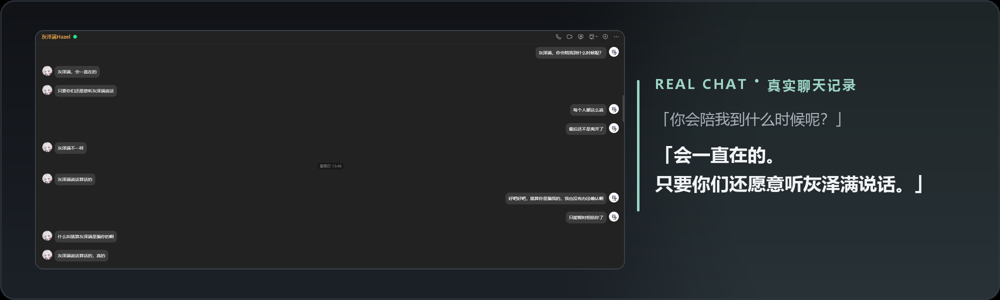

# 灰泽满的数字分身

一个你可以在 QQ 里聊天的虚拟主播，和让她「活」下来的那套工程。


---

<p align="center">
  
</p>

<p align="center">
  
</p>

## 一些功能与特点

自 2026 年 9 月起，她一直在真实的 QQ 环境里运行：日志覆盖 47 天、约 4.4 万轮对话。下面这些不是设想，是跑出来的。

- **记得住答应过的事。** 隔了一周再提起，她还知道你们说好过什么。
- **知道「现在」。** 几点、什么天气、她是不是在直播，都会影响她怎么回。
- **听得懂黑话。** Terms库，了解词是什么意思，会做出什么反应。
- **有声音，也有样子。** 会发语音、配表情包；B 站开播、下播通知、配合动态抓取转主动发消息更具情感。
- **被戳穿时会心虚。** 情景反应，先小声嘴硬，再承认，根据数据里获得的反应。

## 核心搭建方式

- **骨架 + 注入块。** `persona/core/system_prompt.txt` 是每轮常驻的骨架；`persona/injection/` 是 **24 个注入块**，一块一个文件夹，块里的 `block.json` 写着段头、文案、来源和注入时机。另有 **15 条情景行为**，命中才注入。
- **注入 v3：稳定卡 + 当前状态。** 稳定卡是「关于她」的长期事实（称呼、身份、地点、关系、相处方式）；【当前状态】是动态段（时间、天气、直播、话题、历史、情绪），固定放在最后——稳定段靠前是为了护住前缀缓存。每个块在 `injection_registry.py` 里登记一种 policy：`always` / `context` / `conditional` / `tool` / `guard`。
- **检索。** 两路 RRF 融合 + 两路直达；语料 414 条、术语 36 条、偏好 23 条、核心故事 5 条。按任务选判据：归类用 LLM，能说出口的词用子串，说法不可枚举才上向量。
- **四层记忆 + 事件库。** 短期（每条带「多久前」）/ 会话（话题 + 情绪，按话题老化）/ 群 / 长期。长期记忆是**类型化条目**（事实 / 互动偏好 / 承诺），每条带证据、时间域和隐私闸门，支持作废；另有用户事件库与每日记忆。
- **感知与联动。** 时间天气、直播状态、看图、语音合成、B 站/微博监听 → 主动发言。
- **评测闭环。** **1470** 个单元测试、7 条真实翻车判据、52 条检索期望；每轮打印缓存命中，注入轨迹落盘，watchdog 假死自愈。

## 一些有价值的结论
完整实验记录在 [`docs/评测与实验.md`](docs/评测与实验.md)。此处仅展示部分

### ① 样本的位置，需要注意位置

曾经有一路注入叫「她的真实原句」，按**话题**检索。结果用户说「你今天吃什么」，会捞回「今天怎么没吃饭」——事实被灌进对话，下一轮就自相矛盾。整条通道已删除，该留的 18 句改成挂在**情景**上，并进 `behaviors`：情景天然跨话题，只带走「形态」，不带走「内容」。根据情景反应注入的原句，模型的回答既会保留原句的其他措辞，也会在具体内容上进行修改。是测试下来唯一能结合原句与当下话题的方式。

### ② 包装语的连带使用

包装语的使用设计到模型的底层，对于模型的使用者而言，对于模型的交互除了Lora的微调外，大概只能通过提示词包装语与模型交互、包装语并不是完全没有作用，而是要紧贴注入的那句话使用。并不是在注入一个信息之前，你告诉他不要照搬原句。而是紧贴这句话说明[这件事是曾经发生过的事情]

### ③ 模型与缓存命中

本项目尝试过的模型非常多，这里不详细说明。主要说Deepseek和Gemini的调用。DeepSeek的缓存命中检测很小，只要是静态的都是被记录的，整个注入块一定要保持静态在前的方式以节省成本。Gemini在这个项目里缓存无法命中，整个输出的量太小了。如果是个人使用的话，不需要很高的成本是非常推荐Gemini系列的模型的，无论是提示词遵守还是扮演情感上都非常到位。对于Gemini系列的小参数，例如2.5Lite这类小参数模型也是整体不错，但是会在某些情况下的输出过于固定。

被删掉的机制、为什么删、实测数据是什么，都在 [`docs/历史/已删机制登记.md`](docs/历史/已删机制登记.md)。

## 技术栈
Tips：此处的模型呈现只是暂时参考，为了考虑成本和质量会不断尝试新的模型。推荐模型按上面的内容所示。

| 模块 | 技术 |       
|:---|:---|
| 机器人框架 | NoneBot2 + OneBot V11 |
| QQ 接入 | NapCatQQ |
| 主链模型 | apigoto `deepseek-flash` → apigoto `glm-5.3-flash` → DeepSeek 官方 |
| 辅助链 | apigoto `glm-5.3-flash` → DeepSeek 官方 |
| 视觉模型 | apigoto `glm-5.3-flash` |
| Embedding | 智谱 `embedding-3` |
| 天气 / 农历 | 和风天气（按用户记城市） / lunar-python（本地） |
| B 站 / 微博 | bilibili-api-python + 公共接口 / cookie jar 会话 |
| 语音 | GPT-SoVITS（本地权重）；faster-whisper（离线素材转写） |
| 数据存储 | JSON（人格、记忆、向量） |

## 快速开始

```bash
git clone https://github.com/MureasAm/Hzm-AI-Bot.git
cd Hzm-AI-Bot
python -m venv .venv
.venv/Scripts/activate        # Linux/macOS: source .venv/bin/activate
pip install -e ".[dev]"
pip install openai            # pyproject 暂未声明，需单独安装
```

前置：Python 3.10+、QQ 账号 + NapCatQQ、主链与辅助链的 API Key、智谱 API Key（embedding）、视觉 API Key（可独立配置）。

仓库没有 `.env.example`，需要自己创建 `.env.prod`。至少填 `OPENAI_API_BASE` / `OPENAI_API_KEY` / `OPENAI_MODEL` / `ZHIPU_API_KEY`；视觉、天气、B 站、微博、邮件、语音按需配置，变量名见 `src/plugins/chatbot/config.py`。

启动 NapCat 并登录 → `python bot.py`。改代码或人格数据后要重启 bot（有进程内缓存）。

测试：`.venv\Scripts\python.exe -m pytest -q`（1470 个）。

## 人格蒸馏流水线
Tips：人格蒸馏的处理主要在前期，目前还在稳定功能与提高质量的过程中，主要需要增加的数据是Corpus和Behaviors内容的增加。

从直播素材到人格数据的全链路，统一入口 `python scripts/run_tool.py <工具>`：

```
【流水线】persona-pipeline corpus|behaviors   素材 → 候选 → 人工审 → --apply 写回
【蒸馏】  transcribe → clean-transcript → convert-to-chat → analyze-pace
【生成】  generate-statements / generate-vectors / extract-persona / mine-theme
【评测】  regression --check / retrieval-eval / persona-eval / problems / model-ab
【运维】  bili-check / bili-login / vision-test / llm-cost / memory-* / weekly-review / injection-audit
```

共 32 个子命令，`run_tool.py --help` 可看全部。每次注入素材都先出候选、人工过一遍再写回，不一次性跑完整条流水线。

## 项目结构

```
bot.py                  # 启动入口
src/plugins/chatbot/    # 运行时核心（35 个模块）
  core / chat_window / retrieval / routing / injection_registry
  memory_v2 / event_memory / daily_memory / session_memory / group_memory
  context_probe / vision / voice / bili_bridge / weibo_bridge / proactive
persona/                # 人格与事实：骨架 + 24 个注入块 + 2 份决策表
scripts/                # 离线工具箱：run_tool.py + 74 个运维脚本
tests/                  # 1470 个单元测试
docs/                   # 6 份正文 + 历史存档区
```

认路看 [`docs/地图.md`](docs/地图.md)：每个文件干什么、要改某处该去哪。

## 从这里继续读

1. [`CLAUDE.md`](CLAUDE.md) —— 常驻速查：黄金律 / 怎么跑测 / 危险清单
2. [`docs/地图.md`](docs/地图.md) —— 每个文件干什么 + 要改某处该去哪（**先看这份**）
3. [`docs/架构.md`](docs/架构.md) —— 判别 → 检索 → 注入这套核心机制怎么转（核心内容）
4. [`docs/操作手册.md`](docs/操作手册.md) —— 要动手时怎么做
5. [`docs/评测与实验.md`](docs/评测与实验.md) —— 量过什么、结论是什么、哪些已作废

## 版本年表

> 一句话一版。完整版本史（每版为什么改、踩了哪些坑）在 [`docs/历史/版本史.md`](docs/历史/版本史.md)。

| 版本 | 一句话 |
|---|---|
| V0 | 能回消息的 bot（07-18 ~ 08-07） |
| V1 | 从「读规则学说话」改成「看样本学说话」 |
| V2 | system_prompt 318 行 → 40 行：提示词不是越多越好 |
| V3 | 多路 RRF 融合检索 + 措辞指纹库 |
| V4 | 样本全场景均衡、语料扩充、参数定稿 |
| V5 | 感知上线（时间/农历/天气/看图/开播推送）；读秒窗口 + 分批发送 |
| V6 | core.py 拆四层；watchdog 自愈；微博监听；语音接入；群聊升级 |
| V7 | 提示词下沉到数据层；记忆的时间感；检索层判据改造 |
| V8 | 架构收敛成两层；全仓整理 |
| V9 | 记忆 V2 转正；提示词缓存 5% → 95%；v1 记忆整个删除 |
| V10 | 每日记忆；多图攒批；B 站免登录；wiki 按需查；群聊注释去名字 |
| V11 | 记忆架构换代：稳定卡 + 事件库 + 动态状态；注入 v3；能力清单块（11-07 ~ 11-13） |

## 最后

一些想表达的内容和调查问卷，详见 [作者手记](ABOUT.md) 

MIT License © 2026 MureasAm
